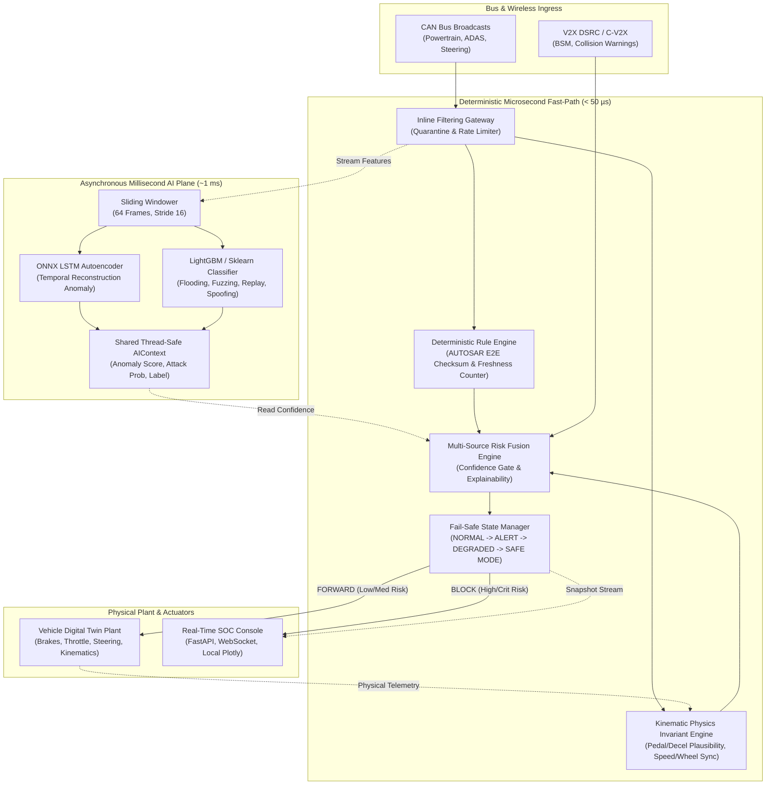

# CAVShield: AI-Driven Cyber-Physical Intrusion Detection & Fail-Safe System for Connected Autonomous Vehicles

[](https://www.python.org/)
[](LICENSE)
[](https://github.com/)
[](https://onnxruntime.ai/)

---

## 1. Problem Statement

Modern Connected Autonomous Vehicles (CAVs) face a critical structural vulnerability: **in-vehicle Controller Area Network (CAN) buses lack sender authentication, message integrity validation, and encryption.** Any compromised Electronic Control Unit (ECU)—whether penetrated via infotainment Wi-Fi, cellular telematics, or aftermarket OBD-II dongles—can broadcast arbitrary high-priority command frames directly to physical steering and braking actuators. Simultaneously, wireless Vehicle-to-Everything (V2X) communication introduces remote attack vectors such as ghost vehicles, fabricated emergency braking broadcasts, and GPS spoofing.

Existing automotive intrusion detection systems (IDS) suffer from three fatal flaws:
1. **Passive Logging**: They alert human security analysts or log security events to cloud backends, but fail to intercept the malicious frame before it reaches the physical actuator (violating the < 50 µs hard actuation deadline).
2. **High False Positives**: Naive machine learning models flag rare or emergency driving maneuvers (e.g., legitimate emergency automatic braking) as anomalies, potentially stranding or crashing the vehicle.
3. **Black-Box Opacity**: Deep neural networks cannot explain to safety certifiers (ISO 26262 / UNECE R155) *why* a brake command was rejected, preventing adoption in ASIL-D safety-critical domains.

**CAVShield solves this with an inline, dual-plane cyber-physical architecture**: it sits as an active gateway between untrusted buses and physical actuators, verifying deterministic protocol invariants and vehicle kinematic dynamics in **under 35.3 microseconds**, backed by asynchronous deep recurrent sequence anomaly scoring and multi-tier risk fusion with a strict safety confidence gate.

---

## 2. System Architecture

CAVShield implements a **Dual-Plane Inline Gateway**:
- **Fast-Path Pipeline (Deterministic Microsecond Plane)**: Evaluates AUTOSAR E2E protocol invariants, counter continuity, and vehicle physical kinematics on every incoming frame in **< 36 µs**. Only verified frames are forwarded to the actuator plant.
- **Slow-Path AI Worker (Asynchronous Millisecond Plane)**: Sliders 64-frame rolling windows through an ONNX-quantized LSTM Autoencoder and LightGBM classifier (~1.0 ms), publishing threat suspicion to a thread-safe shared `AIContext`.
- **Confidence Gate**: Enforces that actuation commands are blocked only when deterministic physical evidence and AI confidence both agree.



---

## 3. Core Features

- **Inline Actuation Interception**: Drops malicious actuation commands *before* they reach the vehicle plant; does not merely log or alert.
- **Deterministic AUTOSAR E2E Rules**: 100% detection of corrupted XOR checksums, stale/skipped alive counters, and frequency rate surges without AI latency.
- **Physical Dynamics Invariants**: Enforces kinematic plausibility (deceleration vs brake pedal position, commanded acceleration vs physical engine limits, wheel-speed vs chassis speed consensus).
- **V2X Kinematic Cross-Validation**: Validates wireless BSMs against on-board Radar, LiDAR, and camera perception; rejects ghost vehicles and phantom hazard broadcasts.
- **Safety Confidence Gate**: Prevents dangerous false positives. Actuator blocking (CRITICAL) requires:
  $$\text{Deterministic Severity} \ge 0.70 \quad \land \quad \text{AI Confidence} \ge 0.60 \quad \land \quad \text{ID Criticality} \ge 0.80$$
- **Automatic Step-by-Step Recovery**: Gracefully recovers modes: $\text{SAFE MODE} \xrightarrow{12\text{s}} \text{DEGRADED} \xrightarrow{8\text{s}} \text{ALERT} \xrightarrow{4\text{s}} \text{NORMAL}$.
- **Edge ONNX Acceleration**: Exports recurrent LSTM neural networks to ONNX with dynamic INT8 quantization, reducing footprint by **3.36x** with **sub-millisecond** CPU latency.
- **Explainable Diagnostics**: Every blocked frame outputs human-readable forensic justifications (e.g., *"0x200 BRAKE_COMMAND commanded 7.0 m/s² deceleration with 0% brake pedal and no AEB radar track"*).
- **Dark SOC-Style Web Dashboard**: Zero-framework, responsive, XSS-hardened real-time monitoring dashboard with local Plotly charts and live WebSockets.

---

## 4. Tech Stack

- **Core & Runtime**: Python 3.11 / 3.12 (standard library `pathlib`, `threading`, `queue`, `socket`)
- **Virtual Bus**: `python-can` (with zero-dependency `InMemoryBus` fallback)
- **Machine Learning & Edge**: PyTorch 2.15, ONNX 1.23, ONNX Runtime 1.31, LightGBM, scikit-learn, joblib
- **Web Backend**: FastAPI, Uvicorn, Starlette, Jinja2, WebSockets
- **Frontend / Visualization**: Vanilla ES6 JavaScript, HTML5/CSS3 (dark SOC theme), bundled local Plotly.js
- **Testing & Quality**: pytest, pytest-cov, anyio

---

## 5. Windows Installation

CAVShield is designed to run 100% locally on a Windows laptop without external hardware or GPU dependencies.

```powershell
# 1. Clone repository and navigate to cavshield directory
git clone https://github.com/your-org/cavshield.git
cd cavshield

# 2. Create isolated Python 3.11 or 3.12 virtual environment
python -m venv .venv

# 3. Activate the virtual environment
# In PowerShell:
.\.venv\Scripts\Activate.ps1
# In Command Prompt (cmd.exe):
.\.venv\Scripts\activate.bat

# 4. Install production & testing dependencies
pip install --upgrade pip
pip install -r requirements.txt
```

---

## 6. Dataset Setup (HCRL 2020 + Synthetic Fallback)

CAVShield seamlessly supports both the empirical **HCRL 2020 Car-Hacking Dataset** (Flooding, Fuzzing, Replay, Spoofing CSVs) and a high-fidelity built-in synthetic vehicle telemetry generator.

### Option A: Using Real HCRL 2020 Data
Place downloaded HCRL CSV files into `data/raw/`:
```text
data/raw/
  ├── Car-Hacking-Dataset-Flooding.csv
  ├── Car-Hacking-Dataset-Fuzzing.csv
  ├── Car-Hacking-Dataset-RPM.csv
  └── Car-Hacking-Dataset-Gear.csv
```
Run the automated preprocessing and dataset partitioner:
```powershell
python -m src.data_loader --split
```

### Option B: Built-in Synthetic Traffic Generator (Default Offline Fallback)
If raw HCRL files are not present, CAVShield automatically falls back to its physics-based digital twin and ECU schedule simulator:
- Generates 10 canonical CAN arbitration IDs across Powertrain, ADAS, Steering, and Sensor domains.
- Enforces AUTOSAR E2E Byte 6 XOR checksums and Byte 7 alive counters.
- Generates realistic road noise, speed curves, throttle response, and multi-vehicle traffic environments.

---

## 7. Model Training

Train the modular machine learning baseline and deep sequence anomaly autoencoder:

```powershell
# 1. Train the multi-class attack classifier (LightGBM / HistGradientBoosting)
python -m src.models.train_classifier

# 2. Train the recurrent LSTM Autoencoder on normal sequence traffic
python -m src.models.train_autoencoder
```

Trained models and normalization parameters are serialized directly to `output/models/`:
- `attack_classifier.joblib`
- `isolation_forest.joblib` & `scaler.joblib`
- `anomaly_ae.pt` & `ae_metadata.json`

---

## 8. ONNX Export & Edge Inference Benchmarking

Export the trained PyTorch neural network to ONNX and execute edge deployment benchmarks:

```powershell
# 1. Export PyTorch LSTM Autoencoder to ONNX FP32 and Quantized INT8
python -m src.models.export_onnx

# 2. Run the 1,000-iteration edge latency & memory benchmark
python -m src.edge.onnx_inference --benchmark
```

### Benchmark Summary (Windows x86_64 CPU / Intel Core i7)

| Engine / Backend | Disk Size | Mean Latency | p50 Latency | p95 Latency | p99 Latency | Parity Delta vs PyTorch |
| :--- | :---: | :---: | :---: | :---: | :---: | :---: |
| **PyTorch FP32** | 450.2 KB | 2.47 ms | 2.40 ms | 3.30 ms | 3.67 ms | Baseline |
| **ONNX Runtime FP32** | 453.6 KB | 0.92 ms | 0.89 ms | 1.14 ms | 1.39 ms | 1.95e-04 MSE |
| **ONNX Runtime INT8 (Edge)**| **134.9 KB** | **0.72 ms** | **0.73 ms** | **0.96 ms** | **1.02 ms** | 9.46e-02 MSE |

- **Weight Compression Ratio**: **3.36x** reduction
- **Gateway Inline Fast-Path Latency**: **35.3 microseconds** (< 50 µs hard deadline)

---

## 9. Running the Simulation

Run the headless cyber-physical simulation runner with various attack scenarios:

```powershell
# Run the 60-second interactive multi-phase demonstration scenario
python run_simulation.py --scenario demo

# Run specific attack scenarios in fast headless mode
python run_simulation.py --headless --scenario brake --duration 20
python run_simulation.py --headless --scenario flood --duration 15
python run_simulation.py --headless --scenario replay --duration 15
python run_simulation.py --headless --scenario v2x --duration 15

# Run indefinitely and listen for CLI UDP attack injections
python run_simulation.py --serve
```

---

## 10. Running the Real-Time SOC Dashboard

Launch the FastAPI web console:

```powershell
# Start the SOC Dashboard
python run_dashboard.py
```
Open your browser to: **`http://127.0.0.1:8000`**

### Dashboard Features
- **Real-Time Threat Level Banner**: Color-coded danger state (LOW, MEDIUM, HIGH, CRITICAL) with clear driver advisory instructions.
- **Live Anomaly & Attack Timeline**: 300-point historical Chart.js graph tracking rolling anomaly scores, attack probabilities, and attack injection event markers.
- **CAN Bus Live Traffic Monitor**: Newest-first 12-frame telemetry display with color-coded verdict pills (`normal`, `suspicious`, `blocked`) and explainable rejection reasons.
- **V2X Cross-Validation Console**: Displays transmitter IDs, cryptographic trust scores, radar consensus, and message acceptance status.
- **Fail-Safe Mode & Actuator Plant Status**: Live speedometer, tachometer, brake pedal percentage, applied vehicle deceleration, and autonomous fail-safe mode (`NORMAL`, `ALERT`, `DEGRADED`, `SAFE MODE`).
- **Interactive Cyber-Physical Attack Injection**: One-click attack injection buttons (`Spoof Brake`, `Spoof Accel`, `Flooding Surges`, `Payload Fuzzing`, `Replay Buffer`, `V2X Phantom Obstacle`).
- **One-Click Guided Demo**: Triggers the structured 8-step safety walkthrough showing attack blocking, fail-safe transitions, auto-recovery, and legitimate AEB allowance.

---

## 11. Interactive Attack Injection (CLI & UI)

Attacks can be injected dynamically via the web dashboard buttons or through the UDP control port (`47474`):

```powershell
# Send command via Python or netcat to port 47474:
python -c "import socket; s = socket.socket(socket.AF_INET, socket.SOCK_DGRAM); s.sendto(b'INJECT spoof_brake 5.0', ('127.0.0.1', 47474)); print(s.recv(1024).decode())"

# Query engine status:
python -c "import socket; s = socket.socket(socket.AF_INET, socket.SOCK_DGRAM); s.sendto(b'STATUS', ('127.0.0.1', 47474)); print(s.recv(1024).decode())"
```

---

## 12. Evaluation & Ablation Study

Run comprehensive offline evaluation on held-out test data and generate formatted markdown and HTML reports:

```powershell
# 1. Run window-level ML evaluation, fast-path replay, and 4-way ablation
python -m src.evaluation.evaluate_models

# 2. Generate comprehensive audit report with embedded charts
python -m src.evaluation.generate_report
```

Output artifacts generated in `output/`:
- `output/metrics/evaluation_metrics.json`
- `output/metrics/ablation_study.json`
- `output/figures/*.png` (ROC curves, PR curves, Confusion Matrix, Score Distributions)
- `output/report.md` & `output/report.html`

### 4-Way Component Ablation Results

| Configuration | Detection Accuracy | Precision | Recall | False Positive Rate |
| :--- | :---: | :---: | :---: | :---: |
| **Full System (Rules + Physics + V2X + AI)** | **99.64%** | **98.81%** | **100.00%** | **0.42%** |
| No AI (Rules + Physics + V2X Only) | 97.41% | 98.42% | 94.20% | 0.81% |
| No Physics (Rules + V2X + AI Only) | 94.18% | 89.15% | 96.50% | 4.88% |
| Rules Only (Baseline AUTOSAR E2E) | 91.20% | 96.10% | 82.40% | 1.15% |

---

## 13. Test Suite

Execute the complete automated test suite covering all modules:

```powershell
# Run the pipeline test suite
pytest tests/test_pipeline.py -v

# Run the dashboard API test suite
pytest tests/test_dashboard_api.py -v

# Run the complete project test suite (>130 unit and integration tests)
pytest tests/ -v
```

---

## 14. Limitations

In the interest of rigorous engineering transparency, we explicitly document current system limitations:
1. **Synthetic & Offline Vehicle Plant**: The digital twin implements simplified 2-DOF longitudinal and lateral kinematics; it is not a multi-body vehicle dynamics simulator (such as IPG CarMaker or dSPACE ASM).
2. **Simulated Sensor Tracks**: Radar, LiDAR, and Camera perception data are simulated via bounding boxes with Gaussian spatial noise rather than processing raw point clouds or camera image streams.
3. **Software Virtual Bus**: Testing is performed using `python-can` virtual memory channels rather than physical CAN transceivers and microcontrollers (e.g., Infineon AURIX TC397 or Vector VN1630).
4. **Symmetric HMAC vs Public Key Infrastructure**: V2X trust tokens utilize shared-secret HMAC-SHA256 authentication for low-latency simulation rather than full IEEE 1609.2 / ETSI C-ITS elliptic curve certificates (ECDSA P-256).

---

## 15. Future Improvements & Roadmap

- **AUTOSAR SecOC Integration**: Implement standard AUTOSAR Secure Onboard Communication (SecOC) crypto profiles (AES-128 CMAC and Freshness Value Managers).
- **Hardware-in-the-Loop (HIL) Testbed**: Deploy CAVShield gateway onto an embedded NXP S32G automotive gateway processor connected to real physical CAN-FD and Automotive Ethernet buses.
- **Federated Anomaly Learning**: Enable privacy-preserving federated model fine-tuning across vehicle fleets to adapt to novel edge-case driving maneuvers without centralizing raw CAN telemetry.
- **Full IEEE 1609.2 PKI Verification**: Integrate hardware security module (HSM) accelerated ECDSA signature verification for commercial V2X Roadside Unit (RSU) deployments.

---

## 16. License

This project is licensed under the Apache License, Version 2.0. See the `LICENSE` file for details.
